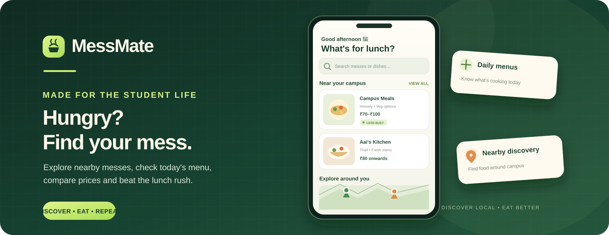
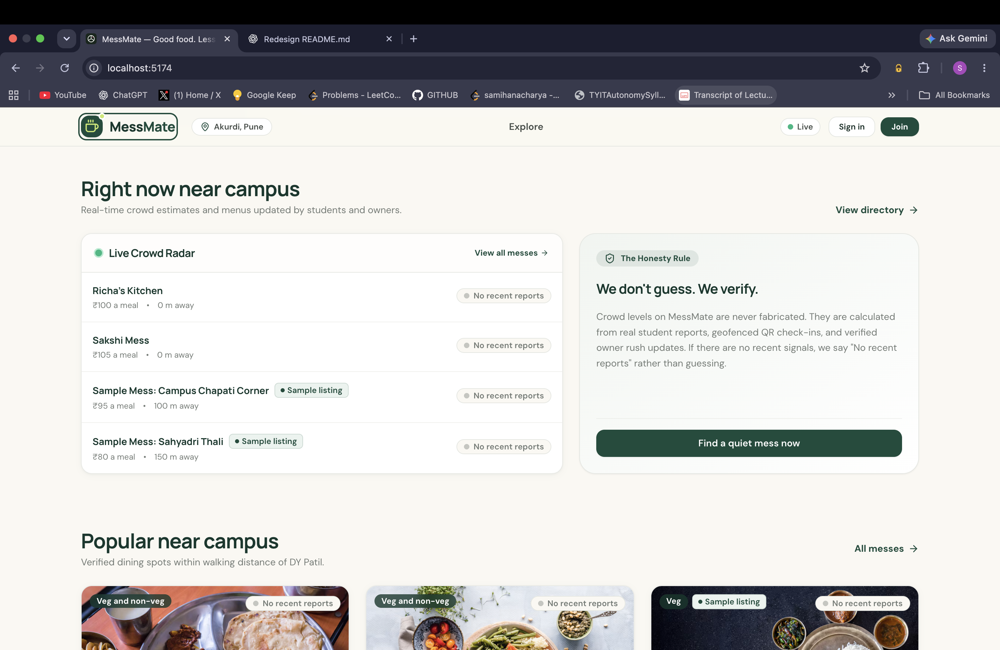
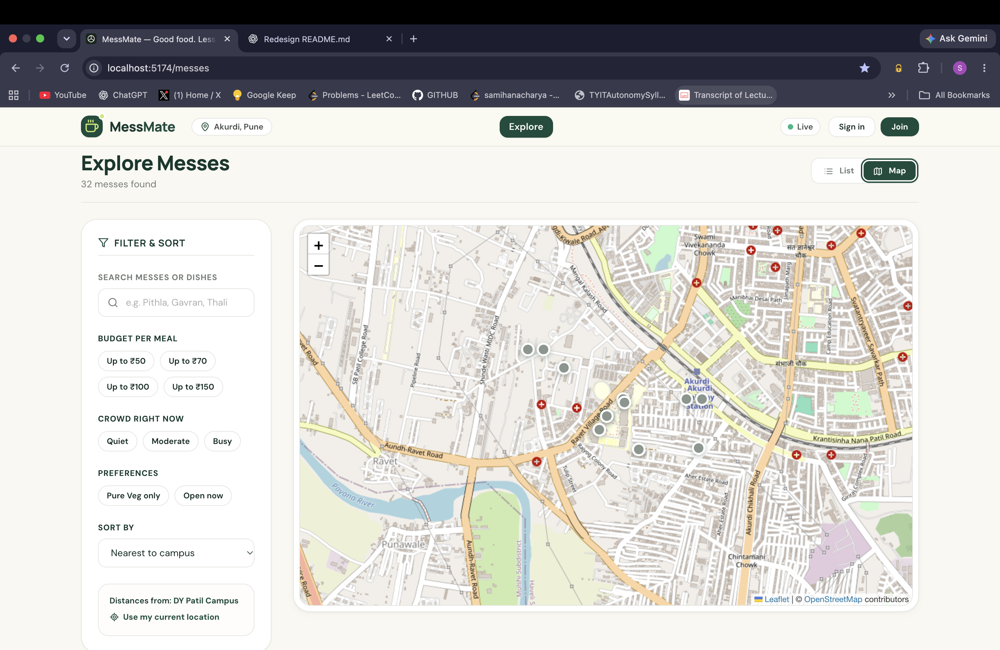
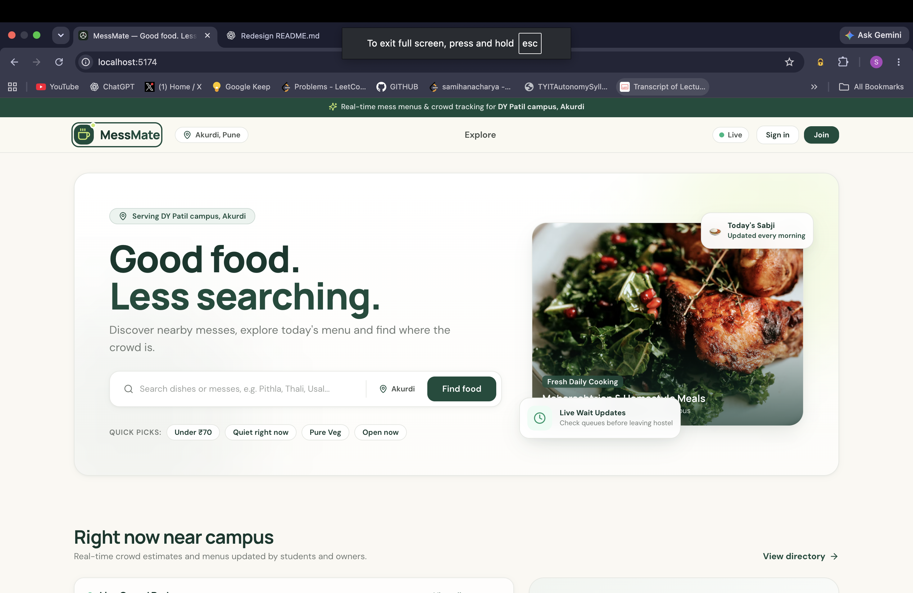
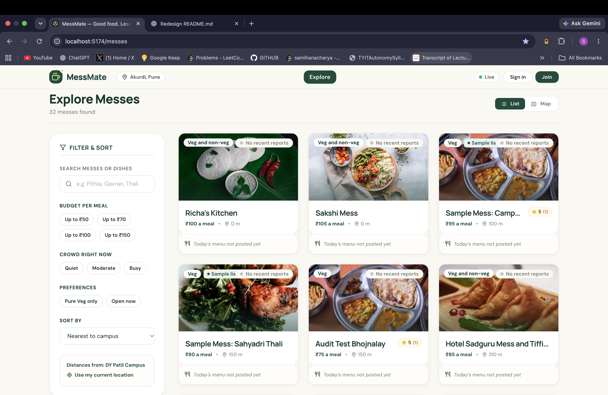

<p align="center">
  
</p>

# 🍽️ MessMate

<p align="center">
  <strong>Find good food. Skip the guesswork.</strong><br/>
  A real-time food discovery platform built for students around DY Patil College of Engineering, Akurdi, Pune.
</p>

<p align="center">
  
  
  
  
  
  
</p>

---

## The problem

When students head out for lunch, the questions are familiar: *Where can I get a good sabji? What is on the menu today? Is it affordable? Is the place crowded?*

MessMate brings local messes into one place so students can compare menus, prices, distance and recent crowd information before they leave.

## What you can do

| For students | For mess owners | For admins |
|---|---|---|
| Search by mess or dish | Manage mess profile and photos | Approve, reject or suspend listings |
| Filter by budget, food type, crowd and open status | Maintain a reusable dish library | Deactivate users and moderate reviews |
| Browse list and map views | Publish daily menus and mark items sold out | Review moderation actions |
| Rate dishes and write reviews | Share crowd updates | Keep the directory trustworthy |
| Submit crowd reports and QR check-ins | Generate printable check-in QR codes | |

### Highlights

- **Daily menus:** See dishes and prices in one place.
- **Crowd awareness:** Crowd estimates use student reports, location-verified QR check-ins and owner updates.
- **Freshness matters:** Crowd information expires automatically and displays its last-updated time.
- **Live updates:** Socket.IO broadcasts relevant changes without requiring a page refresh.
- **Safer interactions:** Role-based access, request validation, rate limiting and moderation controls.

## Product preview

<p align="center">
  
  <br/>
  <strong>Student home</strong> · Today's food options and quick discovery
</p>

<table>
  <tr>
    <td width="50%" align="center">
      
      <br/><strong>Mess discovery</strong>
      <br/><sub>Browse nearby messes and compare options</sub>
    </td>
    <td width="50%" align="center">
      
      <br/><strong>Map view</strong>
      <br/><sub>Explore mess locations around you</sub>
    </td>
  </tr>
  <tr>
    <td colspan="2" align="center">
      
      <br/><strong>Crowd radar</strong>
      <br/><sub>Check crowd activity before heading out</sub>
    </td>
  </tr>
</table>

## Tech stack

| Layer | Technologies |
|---|---|
| Frontend | React 18, TypeScript, Vite, Tailwind CSS |
| Data fetching | TanStack Query |
| Maps | Leaflet, React Leaflet, OpenStreetMap |
| Backend | Node.js, Express, TypeScript |
| Database | PostgreSQL, Prisma ORM |
| Authentication & validation | JWT, bcrypt, Zod |
| Real-time | Socket.IO |
| Testing | Vitest, Node.js test runner |

## Architecture

```text
MessMate/
├── client/                 # React + TypeScript application
├── server/
│   ├── src/
│   │   ├── routes/         # Auth, messes, dishes, check-ins, owner, admin
│   │   ├── services/       # Mess and crowd business logic
│   │   └── lib/            # Shared utilities and crowd estimator
│   └── prisma/             # Schema, migrations and seed scripts
├── docs/                   # API and engineering documentation
└── docker-compose.yml      # Local PostgreSQL
```

The application uses a modular Express API and a React single-page application backed by PostgreSQL. It is intentionally a straightforward modular architecture rather than a collection of unnecessary microservices.

## Run locally

### Prerequisites

- Node.js 20 or later
- npm
- PostgreSQL 14 or later, or Docker

### 1. Clone and install

```bash
git clone https://github.com/samihan45/Mess-Mate-.git
cd Mess-Mate-
npm install
```

### 2. Configure the database and environment

Start the local database if you use Docker:

```bash
docker compose up -d db
```

Create the server environment file:

```bash
cp .env.example server/.env
```

Set at least `DATABASE_URL` and a strong `JWT_SECRET` in `server/.env`. Never commit real credentials.

Generate a JWT secret:

```bash
node -e "console.log(require('crypto').randomBytes(48).toString('base64url'))"
```

### 3. Prepare the database

```bash
npm run db:generate
npm run db:deploy
npm run db:seed
```

### 4. Start the application

```bash
npm run dev
```

The client runs at `http://localhost:5173` and the API runs at `http://localhost:4000` by default.

## Tests and production build

Run the test suites:

```bash
npm test
```

Build both applications:

```bash
npm run build
```

## Data accuracy and demo limitations

MessMate is being developed for a local student community. Seeded/candidate listings, estimated menus and prices, and representative food imagery are **illustrative demo content**. They should not be treated as verified current business information.

Crowd levels are estimates based on available reports and check-ins, not guaranteed live headcounts. When recent evidence is unavailable, the app should communicate that clearly rather than inventing activity.

## Engineering notes

- [Crowd estimation logic](docs/CROWD_ALGORITHM.md)
- [API documentation](docs/API.md)

## Roadmap

- [ ] Capture polished screenshots and publish a hosted demo
- [ ] Onboard mess owners and verify real menus and prices
- [ ] Collect real student feedback and improve crowd estimates
- [ ] Expand automated API, integration and end-to-end test coverage
- [ ] Add production monitoring, backups and managed image storage

## Contributing

Suggestions and bug reports are welcome. Open an issue with steps to reproduce a problem or a clear description of the improvement.

## License

Distributed under the MIT License. See [LICENSE](LICENSE) for details.
